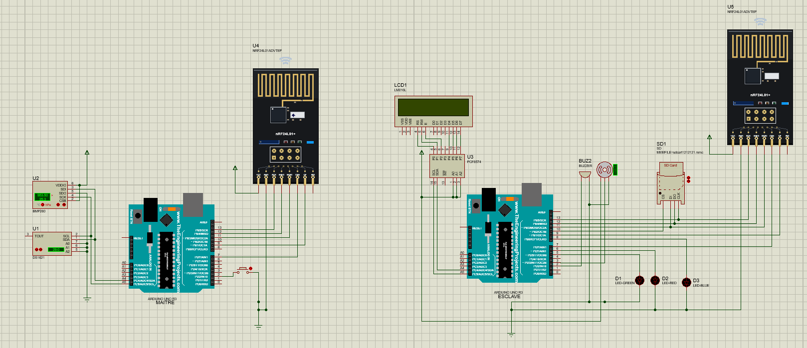
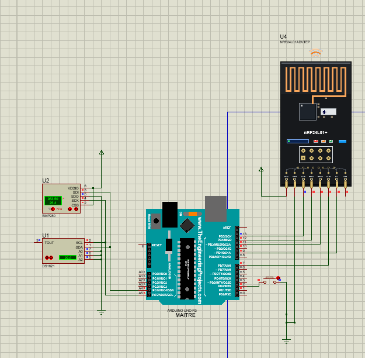
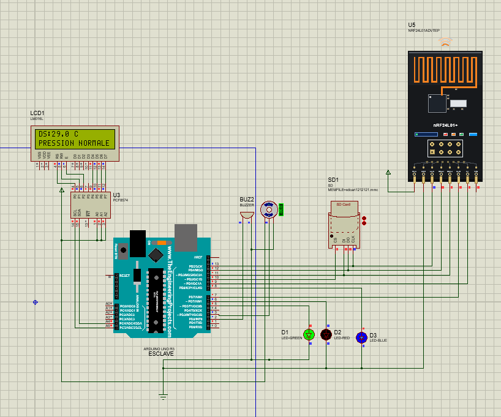
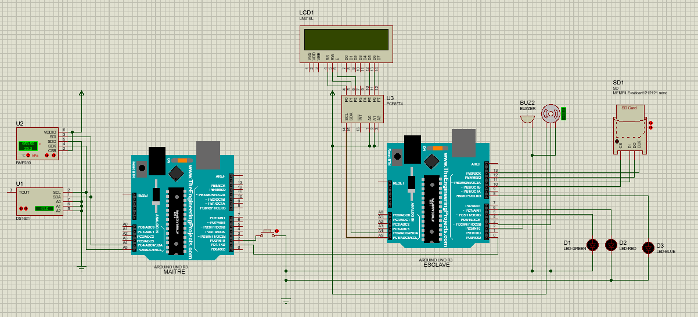
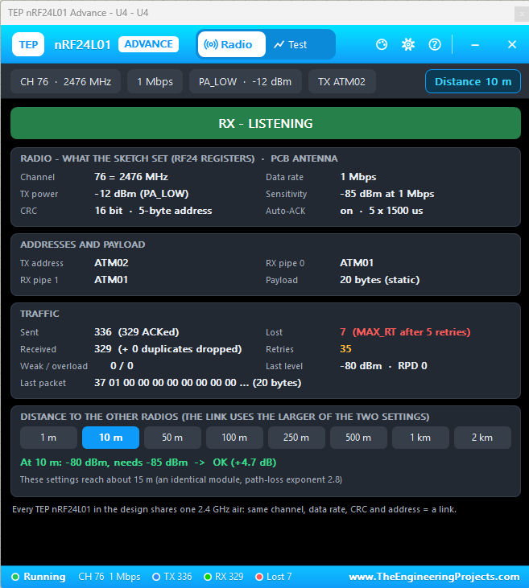
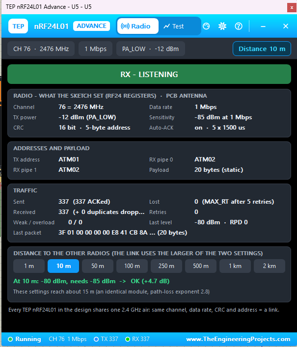

# Atmospheric monitoring station - Uno master / slave

An atmospheric monitoring station using two Arduino Uno boards: a master
reads the DS1621 and BMP280 sensors, while a slave displays measurements,
controls visual and audible alerts, and records data to an SD card.
The two boards now communicate wirelessly through **two nRF24L01 modules**,
not UART.

## Project status

### Restored UART firmware

The last committed UART sketches are available separately in
[UART/MASTER/MASTER.ino](./UART/MASTER/MASTER.ino) and
[UART/SLAVE/SLAVE.ino](./UART/SLAVE/SLAVE.ino).
They are restored without changes from commit
`7c6f1af8fe3ca200e5a938437eac70447a70f966`; the last pre-radio checkpoint
`446af37` contains identical sketch files. This restoration does not certify
physical operation and does not change the nRF24L01 firmware elsewhere.

For this UART version only, power off before rewiring, disconnect the radio
modules and connect master **D1 (TX) -> slave D0 (RX)**, slave **D1 (TX) ->
master D0 (RX)**, and **GND -> GND**. Do not join unrelated supply positive
outputs. Both sketches use the hardware Serial port at **9600 baud** for the
station protocol, not independent diagnostic output.
**Disconnect the inter-board D0/D1 wires during upload**, then reconnect
them with power off. Avoid sending text from a Serial Monitor: the Uno's
USB-serial interface shares D0/D1 and can interfere with the link.
Other pin assignments remain as listed in the wiring section, excluding
all radio wiring. Required libraries are Wire, LiquidCrystal I2C, Servo,
SPI and SdFat 2.x; RF24 and StationRadio are not used by these UART sketches.

- **Final Proteus circuit:** [Project.pdsprj](./Project.pdsprj) is the final
  nRF24L01 version, corresponding to the wireless diagram below.
- **Simulation:** running in Proteus, with bidirectional radio traffic and
  measurement display demonstrated in the screenshots.
- **Real-world testing is in progress.** Physical range, long-term reliability,
  reset behavior and operation under simultaneous SD/servo load still need
  hardware verification. Simulation screenshots are not hardware certification.

The master reads temperature and pressure and sends binary packets every
250 ms. The slave updates a 16x2 LCD, controls status LEDs, a passive buzzer
and an optional flag servo, and records CSV data at up to one row per second.
The external button on master D2 requests a coordinated wireless reset.

## Proteus ISIS project and circuit

### Final wireless circuit

Open [Project.pdsprj](./Project.pdsprj) in a compatible version of Proteus.
**This is the final wireless project, not the previous UART version.**
It corresponds to [image_nRF24L01.png](./image_nRF24L01.png).



The master is on the left with its sensors, D2 button and radio U4.
The slave is on the right with its LCD, SD card, indicators, buzzer and
radio U5. Each Arduino communicates with its own radio over SPI; no UART
wire connects the boards. The servo is supported by the firmware on slave
D3 but is not shown in this diagram. Follow the hardware power and protection
notes below rather than treating simplified simulation wiring as a physical
build guide.

### Master station close-up



The DS1621 and BMP280 share the master's A4/A5 I2C bus. The nRF24L01
uses D11/D12/D13 for SPI. The current firmware uses **master CE D8 and
CSN D10**, replacing D9/D7 shown in the saved diagram. Rewire the master
radio in hardware or Proteus before using the updated firmware. The external D2-to-GND
button starts the wireless reset handshake; the Uno's built-in RESET
button only restarts that Uno.

### Slave station close-up



This running view shows `DS:29.0 C` and `PRESSION NORMALE` on the LCD,
with the green status LED lit. The PCF8574 provides the LCD's I2C interface.
The SD card and radio share the slave's SPI bus but have separate selects:
**SD CS D10 and radio CSN D7**. The blue LED indicates storage status;
red/green indicators reflect sensor and link conditions.

### Previous UART circuit - historical reference only



This image documents the earlier D0/D1 wired connection. It does **not**
represent the final project or the current firmware. Do not reconnect the
inter-board UART wires when using the nRF24L01 version.

## Required software and libraries

Arduino IDE libraries and Proteus simulation models are separate:

| Environment | Requirement | Purpose |
| --- | --- | --- |
| Arduino IDE Boards Manager | Arduino AVR Boards, with Wire timeout support | Compile for Arduino Uno / ATmega328P |
| Arduino IDE Library Manager | **RF24 by TMRh20, Avamander**; version **1.6.2** used for this setup | Native nRF24L01 radio driver for both sketches |
| Arduino sketchbook libraries | Included **StationRadio** folder | Shared packet format and matching radio configuration |
| Arduino IDE Library Manager | LiquidCrystal I2C, compatible with `LiquidCrystal_I2C.h`, `init()` and `backlight()` | Slave 16x2 I2C LCD; earlier setup used version 1.1.2 |
| Arduino IDE Library Manager | Servo | Slave flag servo |
| Arduino IDE Library Manager | **SdFat by Bill Greiman, version 2.x** | Slave FAT16/FAT32 recording using SdFat32 |
| Proteus | Arduino Uno simulation models, if missing | Simulate the two boards |
| Proteus | TEP nRF24L01 library **and model DLL** | Simulate the two radios |
| SD image utility | WinImage or an equivalent tool | Prepare and extract the simulated SD card image |

The master uses Wire directly for the sensors and does not need
Adafruit_BMP280. Wire and SPI come with the Arduino AVR platform.
**BTLE by Florian Echtler is not a replacement for RF24**: this station
uses native nRF24L01 communication, not Bluetooth LE advertising.

### Install RF24 and the other IDE libraries

1. In Arduino IDE, open **Boards Manager** and install **Arduino AVR Boards**.
2. Open **Library Manager**, search for **RF24** and install the entry by
   **TMRh20, Avamander**. Version **1.6.2** is the version used in this setup.
3. Install **LiquidCrystal I2C**, **Servo** and **SdFat 2.x** for the slave.
   Do not substitute the older `SD.h` library for SdFat.
4. Select **Arduino Uno** under **Tools > Board** for both sketches.

### Install the included StationRadio library

StationRadio is a **local library supplied with this repository**, not an
extra Proteus component and not a Library Manager search result. It depends
on RF24 and must be available when compiling either sketch.

1. Download or clone the complete repository.
2. In Arduino IDE, open **File > Preferences** and find **Sketchbook location**.
   Use that path, which may be under Documents, OneDrive or a custom folder.
3. Inside that sketchbook, create a folder named `libraries` if needed.
4. Copy the entire [StationRadio](./StationRadio) folder from this repository
   into `libraries`. Keep its `src` folder and `library.properties` file:

   ```text
   <Sketchbook location>
   └── libraries
       └── StationRadio
           ├── library.properties
           └── src
               └── StationRadio.h
   ```

5. Restart Arduino IDE if it was open. Open
   [MASTER/MASTER.ino](./MASTER/MASTER.ino) and
   [SLAVE/SLAVE.ino](./SLAVE/SLAVE.ino) from their respective sketch folders.
   Both include `#include <StationRadio.h>`.
6. Compile each sketch for Arduino Uno. For Proteus, use **Sketch > Export
   Compiled Binary**, then select the corresponding exported `.hex` in each
   simulated Uno's **Program File** property. For physical boards, select
   the appropriate port and upload each sketch to its own Uno.

After an update to StationRadio, **replace the installed folder with the
repository's updated version, recompile both sketches and reload both
firmware files**. Otherwise, Arduino IDE may keep using an older installed
copy with different timing or protocol settings.

- `StationRadio.h: No such file or directory`: check the sketchbook location
  and folder structure; avoid an extra `StationRadio/StationRadio` nesting.
- `RF24.h: No such file or directory`: install RF24 through Library Manager.
- Proteus model/DLL errors are unrelated to these Arduino header errors;
  follow the next section.

### Install the nRF24L01 Proteus model

**The nRF24L01 model used here is not available natively in Proteus.**
Download and install the external library from the package used for this
project:

**[Download the TEP nRF24L01 Proteus library](https://www.theengineeringprojects.com/project-file/blog/nrf24l01-proteus-library/1)**

The publisher also provides an
[installation walkthrough](https://www.theengineeringprojects.com/2026/09/nrf24l01-proteus-library.html).

1. Close Proteus and extract the complete downloaded archive.
2. Copy the package's radio library files, including `TEPNRF24L01.LIB`,
   into the **LIBRARY** folder of the Proteus installation you use.
3. Copy **`TEPNRF24L01.DLL`** into that installation's **MODELS** folder.
   Install any other supplied model dependencies according to the publisher's
   instructions. Use matching library and DLL versions from the same package.
4. Restart Proteus and open [Project.pdsprj](./Project.pdsprj).
   The final project already contains the two radio components.

A typical installation root is
`C:\Program Files (x86)\Labcenter Electronics\Proteus 8 Professional`,
but the location depends on your installation. Installing RF24 in Arduino
IDE does **not** install the Proteus model.

If Proteus reports **`External model DLL "TEPNRF24L01.DLL" not found`** with
**`GLE=0x0000007E`**, check the MODELS location and package dependencies:
Windows may be unable to find the DLL itself or one of the DLLs it needs.
Check the publisher's version requirements; do not download replacement
DLLs from unrelated DLL websites.

### Simulation setup

1. Open [Project.pdsprj](./Project.pdsprj) in Proteus.
2. Install the IDE libraries, local StationRadio library and Proteus models
   described above. If your installation lacks the Arduino Uno or other
   component models, install those as well.
3. Compile [MASTER/MASTER.ino](./MASTER/MASTER.ino) and
   [SLAVE/SLAVE.ino](./SLAVE/SLAVE.ino) for Arduino Uno in the Arduino IDE,
   export the compiled binaries, and set each simulated board's program
   file to the corresponding compiled firmware. Update any existing
   machine-specific firmware paths in the project.
4. For **SD card functionality in the simulation**, use a disk-image tool
   such as **WinImage** to create or prepare a writable **FAT16/FAT32**
   SD card image in a format supported by the Proteus SD model. Select that
   image in the simulated card's properties; the project file alone does
   not provide a prepared SD card image. Do not use exFAT.
5. Run the simulation. Stop it before opening the card image in WinImage
   to inspect or extract the generated `LOGnnnnn.CSV` files; do not modify
   the same image from both programs at once.

WinImage (or an equivalent image utility) is for the simulated SD card.
On real hardware, use a physical FAT16/FAT32 card instead. Simulation
does not replace the hardware acceptance checks at the end of this README.

## What the four tests establish

- TEST1: LCD address `0x27`, 16 columns / 2 rows, red LED D6, green LED D5,
  button D4 to GND with `INPUT_PULLUP`. Its button toggles LEDs, not reset.
- TEST2 and TEST4: UART commands between boards on D0/D1.
  They use SoftwareSerial on the hardware UART pins. They are historical
  wired tests, not tests of the final nRF24L01 communication.
- TEST3: DS1621 at `0x48`, BMP280 at `0x76` or `0x77`, sensor acquisition,
  9600-baud measurement frames and a 3 ms Wire timeout. That test uses D10/D11;
  the final sketches use the nRF24L01 instead. It only detects the BMP280 at boot
  and does not check each later transaction or retry after disconnection.

The original tests are unchanged.

## Wiring

Use these current firmware pin assignments. The saved Proteus project and
screenshots predate the master CE/CSN change: update the master's CE from
D9 to D8 and CSN from D7 to D10 in that circuit. Slave wiring is unchanged.
Firmware and library installation are covered above.

| Connection | Wiring |
| --- | --- |
| Each nRF24L01 VCC / GND | Local 3.3 V / local Arduino GND; never 5 V VCC on a bare module |
| Master nRF24L01 CE / CSN | Master D8 / D10 |
| Slave nRF24L01 CE / CSN | Slave D9 / D7 (not D10: reserved for SD) |
| Each nRF24L01 MOSI | Its Arduino D11 |
| Each nRF24L01 MISO | Its Arduino D12 |
| Each nRF24L01 SCK | Its Arduino D13 |
| Each nRF24L01 IRQ | Not connected; the sketches poll the radio |
| Master sensor I2C | DS1621 and BMP280 SDA -> A4, SCL -> A5 |
| Slave LCD I2C | LCD SDA -> A4, SCL -> A5; address `0x27` |
| Slave red LED | D6 -> 330 ohm series resistor -> LED -> GND |
| Slave green LED | D5 -> 330 ohm series resistor -> LED -> GND |
| Master reset button | Master D2 -> button -> GND (`INPUT_PULLUP`) |
| Slave passive buzzer | Slave D2 -> low-current passive piezo +, piezo - -> GND |
| Slave flag servo signal | Slave D3 -> servo signal wire |
| Slave blue SD LED | D8 -> 330 ohm series resistor -> blue LED -> GND |
| Slave SD module CS | D10 |
| Slave SD module MOSI | D11 |
| Slave SD module MISO | D12 |
| Slave SD module SCK | D13 |

There is no longer a button on slave D4. D2 is used separately on each
board: master D2 is the button, slave D2 is the buzzer. Do not join them.
The servo is now on slave D3, not D8: D8 is only for the blue LED.
Master D8 is independently used for its radio CE. Hardware SPI on Uno
remains MOSI D11, MISO D12 and SCK D13; changing CE/CSN does not bypass
those three SPI pins or resolve a fault on them.

The slave's radio and SD card share D11/D12/D13, with independent chip
selects: **radio CSN D7, SD CS D10**. Both selects are driven HIGH before
initialization. RF24 and SdFat use SPI transactions; the unselected SD module
must release MISO. Do not connect both chip selects together.

For real radios, use a stable 3.3 V supply with a 10 uF capacitor and
100 nF ceramic capacitor close to each module. Use a suitably rated separate
3.3 V regulator for PA/LNA modules. Keep radio wiring short and isolate
servo supply noise. Separate wireless stations do not require a ground wire
between them; each module must share its own Arduino's ground.

Use a suitable regulated supply for the servo, with its ground connected
to slave GND. Do not power the servo from a GPIO pin; avoid loading the Uno
5 V rail with servo starting/stall current. Do not join unrelated supply
positive outputs. Keep the servo's 0/180-degree travel clear and adjust the
position constants if the mechanism hits a stop.

Connect the SD module's GND to slave GND. Power it according to the exact
module's markings/specification: a bare SD card is a 3.3 V device. Verify
that the module regulates its supply and level-shifts the Uno's 5 V SPI
signals; do not assume all modules marked "MH" do so.

The buzzer code uses `tone()` for a **passive** piezo. A buzzer needing more
current than an Uno GPIO supports needs a suitable driver, not direct GPIO
power. On Uno, Servo uses Timer1 and tone uses Timer2; the LEDs on D5/D6
are controlled with digitalWrite, not PWM.

Keep the master sensor I2C bus separate from the slave LCD I2C bus.
Each bare LED needs its own series resistor. Do not connect an LED directly
between an Uno output and GND: excessive current can damage the LED or
output pin and cause unreliable brightness. Alert and reset animation use
the same full-HIGH ON level; there is no PWM brightness reduction.
Preserve the working sensor power, address-pin wiring and pull-ups from the
tests. A bare BMP280 is a 3.3 V device: do not apply 5 V power or I2C levels
unless the breakout explicitly supports them with regulation/level shifting.

**Remove both D0/D1 inter-board wires permanently.** Serial is now only for
local diagnostic output at **115200 baud** on either board. Opening Serial
Monitor can reset an Uno, as usual. Power the boards appropriately without
tying unrelated power supplies together.

## Radio connection and LCD messages

### TEST5: standalone Hello World hardware test

The two examples supplied in `test.md` are adapted in
[TEST5/EMETTEUR/EMETTEUR.ino](./TEST5/EMETTEUR/EMETTEUR.ino) and
[TEST5/RECEPTEUR/RECEPTEUR.ino](./TEST5/RECEPTEUR/RECEPTEUR.ino).
Open each sketch separately and upload EMETTEUR to the master Uno
(CE D7, CSN D8) and RECEPTEUR to the slave Uno (CE D7, CSN D9).
These TEST5-only pins match the confirmed standalone test wiring; they differ
from the full station firmware. The v2 startup banners identify these builds,
and the `[PINS]` lines print the actual constants used by RF24.
Both use MOSI D11, MISO D12, SCK D13, local GND and 3.3 V radio power.
Only RF24 and the built-in SPI library are needed, not StationRadio.

For isolation, disconnect peripherals other than the radios before testing,
with power off before rewiring. Keep both boards powered simultaneously
and open their Serial Monitors at **115200 baud**. These tests replace
the station firmware temporarily and do not run its LCD, sensors or storage.
The sender transmits `Hello World !!!` once per second using address
`PIPE1`, channel 76, 1 Mbps and PA_MIN.
Expect `[TX] ... ACK OK` on the sender and `[RX] ... message=Hello World !!!`
on the receiver. A hardware ACK confirms radio acknowledgement, not that
the receiver sketch has printed the message. Both sketches report local
SPI presence and channel readback periodically. An initialization error
stops the test until the board is restarted; no automatic retry is performed.

No manual pairing button is needed. Both radios use channel **76**
(2476 MHz), **1 Mbps**, low transmit power, 5-byte addresses `ATM01` (master)
and `ATM02` (slave), 16-bit hardware CRC, automatic ACKs and bounded retries.
Keep these settings identical in the shared library on both boards.
These fixed addresses are not authentication or encryption.

| LCD message | Meaning |
| --- | --- |
| `INIT NRF24...` / `PATIENTER...` | Initializing storage and the radio |
| `RADIO OK` / `RECHERCHE MASTER` | Local radio responds over SPI; no valid master measurement yet |
| `DS:... C` / `MASTER CONNECTE` | First valid measurement received; short confirmation, then normal pages |
| `LIAISON PERDUE` / `RECHERCHE MASTER` | No valid new measurement for 3.5 seconds |
| `DS:... C` / `LIEN RETABLI` | Valid measurements resumed after a lost link |
| `ERREUR NRF24` / `VERIF 3V3 / SPI` | Local radio initialization/presence failed; check supply, CE/CSN and SPI |

Connection confirmations last 700 ms without blocking reception, servo,
buzzer or logging. Sensor/frame warnings and measured alarms take precedence
over a connection confirmation. Sensor values can legitimately be `NaN` even
when the radio is connected; the normal sensor warnings then remain visible
instead of the success banner. A radio that fails initialization is retried
every three seconds, and its SPI presence is checked once a second.

The slave sends an application-level acceptance for valid measurements.
The master's Serial Monitor prints `SLAVE CONNECTED` only after receiving
that matching reply, not merely after a hardware ACK. It also reports lost
links, radio failures, transmission failures and reset acceptance. The slave
prints connection changes and invalid packets to its own Serial Monitor.
There is no claim that `radio.begin()` alone confirms the other board.

### Serial diagnostics on real boards

Open each board's Serial Monitor at **115200 baud** and capture at least
15 seconds with both boards powered. Opening the monitor can reset that Uno.
The `[BOOT MASTER]` / `[BOOT SLAVE] StationRadio diagnostic v2` banner confirms
the diagnostic build is running. It is also printed on radio reinitialization.

- `[NRF INIT]` identifies the radio pins and the initialization stage.
  An initialization failure or lost SPI presence points to the local
  radio/power/SPI interface, not proof of a remote board failure.
- `[NRF CONFIG]` reads back channel, data rate and payload size; expect
  `channel=76/76 rate=1Mbps payload=20/20`. TX/RX addresses in this line
  describe the intended configuration, not register readback.
- `[NRF STATS]` appears every five seconds. Counters are cumulative since
  Arduino startup: `tx` counts attempted hardware writes, `ack` successful
  hardware acknowledgements, `fail` unacknowledged writes, `rx` reads,
  `headerOK` matching protocol headers, and `rejected` rejected packets.
  A rejected packet can have a valid header, for example an unexpected reply
  sequence or invalid sensor values. Writes skipped while not ready are not
  counted. A hardware ACK alone does not confirm application acceptance.
- `[NRF RX REJECTED]` shows the reason, decoded header and all 20 raw bytes.
  Details are limited to one packet per five seconds (the first is immediate);
  counters still include every rejection. Repeated all-zero/all-FF data
  suggests checking local SPI/power first, but is not a definitive diagnosis.
  Other invalid headers can indicate different installed library/firmware
  versions. Reception is bounded to three packets per loop so a faulty SPI
  bus cannot trap the sketch in an endless receive loop.

If master `tx` increases but `ack` stays zero, check both radios' supplies,
wiring and matching settings. If slave `rx` stays zero, no packets have been
read there. If `rx` rises but `headerOK` stays zero, inspect the raw bytes and
compare the installed StationRadio versions. `SLAVE CONNECTED` remains the
master's confirmation that a matching application reply was received.
`SD unavailable` is a separate storage diagnostic, not a radio ACK error.

**Replace the installed StationRadio library with this repository's updated
folder, then compile and upload BOTH sketches.** Updating only the sketches
does not install the shared diagnostics.

### Master radio control panel



The master sends to `ATM02` and listens on receive pipe 1 at `ATM01`.
The panel shows channel 76 / 2476 MHz, 1 Mbps, PA_LOW (-12 dBm), 16-bit
CRC, 5-byte addresses and static 20-byte payloads, matching StationRadio.
`RX - LISTENING` is normal between transmissions; the master also receives
the slave's application replies.

In this particular screenshot, 336 transmissions were attempted, 329 were
acknowledged and 7 reached the retry limit. A missing hardware ACK does not
prove that the payload was never received. These counters are a snapshot,
not a long-term reliability measurement.

### Slave radio control panel



The slave sends replies to `ATM01` and listens on pipe 1 at `ATM02`.
Its radio settings match the master's, with the transmit and receive
addresses reversed. This screenshot shows 337 transmissions, all 337
acknowledged, and zero retry-limit failures. Different totals between
screenshots should not be treated as directly synchronized measurements.

Both panels show a simulated distance of 10 m, a received level around
-80 dBm and approximately 4.7 dB of link margin. Their estimated range of
about 15 m applies to the model and settings, **not a guaranteed real-world
range**. `Weak / overload = 0 / 0` reports no such model events in these
captures. The hexadecimal last-packet display is expected for binary data.

## LCD and LEDs

A 16x2 LCD cannot fit
all measurements and messages on one screen.
Instead, it cycles every 900 ms through three pages:

| First row (always) | Second row |
| --- | --- |
| `DS:25.0 C` | `BMPR:1013.2 hPa` |
| `DS:25.0 C` | `NORMALE TEMP` or `ALERT TEMP` |
| `DS:25.0 C` | `PRESSION NORMALE` or `ALERT PRESS` |

Displayed values have one decimal place; radio packets retain the original
32-bit floating-point values, so display rounding does not decide alarms.
CSV output formats those values with six decimal places.
Only the DS1621 temperature **>= 30.0 C**
triggers `ALERT TEMP`. Pressure **< 950.0 or > 1050.0 hPa** triggers
`ALERT PRESS`; the endpoints themselves are normal. These pressure limits
are a demonstration range, not a safety threshold or weather forecast.
Thresholds are constants near the top of the slave sketch.

Green means DS temperature is available and below 30 C, any available
pressure is within the normal range, and the communication link is healthy.
Red means a temperature/pressure alert, missing DS temperature, bad frame
or lost link. BMP temperature is not displayed and never controls an alarm.
The master still reads it internally because BMP pressure calculation needs
temperature correction; its existing field remains in the checked data frame.
A missing BMP280 is a displayed warning, not by itself a red LED alarm:
with the BMP280 removed, DS temperature alone controls the temperature alert
and LEDs (green below 30 C, red at or above 30 C). Its absent pressure does
not trigger a pressure alarm. `NORMALE TEMP` / `ALERT TEMP` remain on the
temperature status page, and `CHECK BMP280` appears on the other status page.
If the DS1621 fails, BMP temperature is not used as a replacement:
the LCD shows `DS:NaN C` / `CHECK DS1621`, with a red flag/LED.
Missing data and communication faults are visual warnings, not buzzer alarms.

## Buzzer and flag servo

- Boot: rising three-note tune; flag centered at 90 degrees for at least
  500 ms, and stays centered until data arrives (up to the 3.5-second link
  timeout). Both LEDs are off while waiting at boot.
- Normal: green LED, green flag at 0 degrees, no sound.
- Temperature/pressure alert: red LED, red flag at 180 degrees, continuous
  1600 Hz tone while fresh measurements remain outside the limits.
  Missing DS data, bad frames and lost communication give red LED/flag but
  no continuous sound. In particular, radio errors caused by an SD retry
  must not produce a periodic beep. A missing BMP alone is still only a
  warning when DS temperature is normal.
- Reset: flag returns to 90 degrees and stays there while the LEDs alternate;
  a falling three-note tune replaces any alarm tone, then stops.

Sound patterns use elapsed time rather than delay(), so the LCD, radio
receiver and servo continue working while notes play.

## SD recording and blue LED

The Uno has only 2 KB of RAM, shared by global variables, library buffers,
temporary variables and function calls. The slave keeps fixed LCD messages,
log headings and format strings in program memory using F()/PSTR(), and
uses bounded small text buffers. SD still needs a sector buffer (512 bytes).
Check the Arduino IDE's reported global RAM usage and remaining bytes
after compilation, especially when changing libraries or adding features.
That report does not include the maximum temporary memory used at runtime,
so free reported RAM is not itself proof of stability.

- At every slave boot (including after reset), check the card and writable
  FAT16/FAT32 filesystem. Without a usable card, show `SD ABSENTE / HS` once
  for two seconds when the normal display is available, then return to its
  pages. Radio error/search and connection messages take precedence, so the
  SD notice may be deferred until the master connects. A card/file writing
  problem instead shows `ERREUR ECRIT SD`. Red/green LEDs, flag and sound
  still depend on sensor/link alarms, not on missing storage.
- Blue blinks approximately every 300 ms while recording is unavailable.
  Retry initialization every five seconds, so insertion is detected without
  another reset. Blue stays on only after initialization and saving a
  session header succeed.
- While a card is ready, check its identity once a second and append the
  latest checked temperature/pressure sample, with writes limited to 1 Hz
  even though radio updates arrive at 4 Hz.
  Check the write, sync and close results; on failure, stop recording,
  blink blue and show one short warning. Resume automatically after a
  usable card is detected again.
- Each successful card mount creates a new **LOG00001.CSV**, **LOG00002.CSV**,
  etc., choosing the first unused number up to 99999. No existing file is
  overwritten, including old MESURES.TXT recordings. Entries append within
  that session; a reset or remount starts a new file with one header. Example:

  ```text
  sep=;
  Temps_s;Temperature_DS_C;Pression_BMP_hPa;Alerte_temperature;Alerte_pression
  12,345;25,500000;1013,250000;NORMAL;NORMAL
  13,345;31,000000;947,929260;ALERTE;ALERTE
  14,345;29,000000;NaN;NORMAL;INDISPONIBLE
  ```

`Temps_s` is the slave's receive time in seconds since restart, with three
decimal places (wraps after about 49.7 days), not a calendar date. Measurements
retain six decimals, and alert columns use the original unrounded values:
DS >= 30 C; pressure < 950 or > 1050 hPa. Missing values are `NaN` with
`INDISPONIBLE` status, not a normal or measured-alert state.
Invalid radio packets, immediate duplicate samples and stale display values
are not logged.

The CSV targets French Excel: semicolon-separated columns, decimal commas,
and an Excel `sep=;` line. Extract the CSV from the stopped Proteus image
before opening it in Excel. If importing manually, select delimiter `;`,
French numeric locale and skip the `sep=;` line. For clearer presentation,
format numeric columns to one or two decimals in Excel; the stored precision
is retained. Select time and either measurement column to insert a chart.
The project owner has run the wireless simulation; real-world SD recording
and long-duration operation remain part of the hardware testing in progress.

Without a card, measurements continue but are **not stored or replayed**
later. The Uno cannot write into the PC project directory without a
separate PC bridge; that feature was explicitly deferred.

There is no card-detect switch connected. An initialization failure cannot
distinguish an absent card from bad wiring/power, and a filesystem failure
can mean an unsupported format. An empty module cannot be verified as
working until a real supported card is available. Use FAT16/FAT32, not
exFAT. No automatic formatting is performed.

SD initialization and writes are synchronous library operations: they may
briefly pause the loop, including the blue blink and animation updates,
especially with a missing/bad card. Boot starts the radio before attempting
storage, giving the initial connection and replies priority. SD initialization
is deferred until a measurement is received or the 3.5-second startup wait
expires, and the boot melody has finished. Runtime retries are spaced out and are
not performed during reset or the boot melody. Long card stalls can lose
radio samples (the radio's RX FIFO holds only three packets); the Uno does
not buffer a recording backlog, and when
multiple samples arrive together only the latest is queued for logging.

Sync/close per entry reduces risk but does not make live card removal or
power loss safe. Prefer powering down before removing a card; unexpected
removal can lose the current entry or damage the filesystem.

## Wireless packet format

The link carries **four 20-byte binary measurement packets per second**, not
the old UART text line (which could exceed the radio's 32-byte limit).
The shared library defines its 32-bit sequence, three 32-bit floats, station
magic value, protocol version and message type. The radio's 16-bit CRC checks
transmission integrity. The slave also checks the header, sensor ranges and
BMP temperature/pressure availability consistency before updating anything.
`NaN` is an explicit missing reading. Immediate duplicate measurement
sequences are acknowledged but do not refresh the timeout or append CSV rows.
Invalid packets are discarded without overwriting good data;
`ERREUR TRAME` appears on the status page until a valid frame arrives.
After 3.5 seconds without a valid new packet, the LCD shows `LIAISON PERDUE`
and `RECHERCHE MASTER` rather than stale measurements.

## Button reset

Use the external button on **master D2**, not the Uno's built-in RESET button.
After 30 ms debounce, the master sends a `RESET_REQUEST` packet. The slave
replies with `RESET_ACCEPTED` carrying the same sequence, centers
the flag, plays the falling reset tune, displays `RESET SYSTEME`, draws a
progress bar and alternates LEDs with increasing speed for 900 ms.
It then displays `REDEMARRAGE...` for 400 ms and resets via its watchdog.
The master waits 1.6 seconds after receiving acceptance before resetting itself,
giving the slave time to finish.

If no application reply arrives, the master retries the same request every
100 ms for up to 1.5 seconds and resets itself after 3.1 seconds total.
A radio hardware ACK alone does not count as reset acceptance. The slave
defers acceptance by 40 ms to let the master return to receive mode and
retries failed acceptance transmissions every 40 ms during its reset sequence.
Measurement replies are deferred by 5 ms and retried for at most 100 ms;
a missing reply cannot postpone SD work indefinitely.
Repeated matching requests get another reply but do not restart
the slave animation. The master cannot guarantee a slave reset if the link
is broken. Standard Uno Optiboot supports watchdog resets.
A button held down across reboot requests another reset; release it after
pressing.

Use the button wired **between master D2 and GND**, held for at least
100 ms of simulation time. The Uno's built-in RESET button restarts only
that board and cannot send the wireless reset request. At 115200 baud, the
master logs `RESET BUTTON PRESSED (D2)`, the request and its acceptance.
The slave logs `MASTER RESET REQUEST ACCEPTED` when its animation starts.

### Responsiveness and simulation speed

Measurements are read/transmitted every 250 ms; the BMP280 now uses minimum
standby instead of a one-second pause. The DS1621 still needs roughly
750 ms for a physical conversion, plus its initial setup wait: sending
faster does not make that sensor convert faster. LCD drawing is limited to
20 refresh opportunities per second and radio FIFO polling to once per
2 ms when empty, avoiding unnecessary SPI/I2C work. Alert/servo decisions
still run each loop. CSV logging remains limited to one row per second.

These times are **simulation time**, not guaranteed wall-clock time. Proteus
may still run slower than real time. A steady blue LED means the card was
initialized successfully; it does not prove how fast the simulation runs.
An unlit blue LED is different from a steady lit LED and needs checking.
Synchronous SD operations can still delay reception/reset handling.

## Hardware acceptance checks

**Real-world testing is in progress.** The project owner has demonstrated
the running Proteus simulation and radio traffic shown above. This does not
establish that every fault, reset and storage case below has passed on
physical boards. Use this checklist for continued Proteus and hardware
validation; measured range and long-term reliability are not yet established.

1. Boot: rising tune and centered flag, then DS temperature and BMP pressure
   appear; normal readings give green LED/flag and silence.
2. DS temperature reaches exactly 30 C: red LED/flag, `ALERT TEMP`, steady tone.
   BMP temperature changes alone must not trigger a temperature alarm.
3. Pressure outside 950..1050 hPa: red LED/flag, `ALERT PRESS`, steady tone.
4. Unplug/interrupt only the BMP280: DS continues when the bus is free,
   both BMP values show `NaN`, `CHECK BMP280`, no frozen application.
   DS below 30 C gives green and `NORMALE TEMP`; DS at or above 30 C
   gives red and `ALERT TEMP`. The missing BMP alone does not force red.
5. Restore BMP280: automatic rediscovery and fresh readings resume.
6. Stop the master or interrupt the RF link: within 3.5 s,
   `LIAISON PERDUE` / `RECHERCHE MASTER`, red, no stale data and no link-fault
   buzzer. Restore it: `LIEN RETABLI`, then normal pages.
7. Press master D2: centered flag, falling tune, LCD reset message,
   accelerating alternating LEDs, both boards restart.
8. Disconnect the slave and press master D2: master still restarts after
   its bounded wait. No slave restart can be promised over a disconnected link.
9. Boot/reset with no SD: one short LCD warning, blinking blue, sensor
   displays and red/green alarms still work.
10. Insert a writable FAT16/FAT32 card: after a retry, blue stays on and
    the new LOGnnnnn.CSV contains elapsed seconds, DS temperatures, BMP
    pressures and separate alert columns.
    Verify actual file contents on a PC after powering down and removing it.
11. Start with the slave only: `RADIO OK` / `RECHERCHE MASTER` must not
    claim a connection. Start the master with healthy sensors:
    `MASTER CONNECTE` appears briefly; its Serial Monitor confirms
    `SLAVE CONNECTED` after the application reply.
12. Start the slave without its radio: `ERREUR NRF24` / `VERIF 3V3 / SPI`.
    Restore the correctly powered radio: automatic retry, then master search.
13. Confirm SD writes and radio reception work together on the shared SPI
    bus. Reset while recording; the animation must run and the next boot
    must create a new CSV session.

These checks must be performed on the actual boards; host-side tests cannot
reproduce loose solder joints, bus wiring or the physical LCD.

---

Made with love by HAMZA Z
